<!-- ============ HEADER ============ -->
<div align="center">
  
</div>

<div align="center">
  <a href="https://git.io/typing-svg">
    
  </a>
</div>

<div align="center">


</div>

---

## 👾 Sobre mim

```javascript
const ailton = {
  cargo:       "Consultor ServiceNow @ EDX — Extreme Digital Experience",
  atuação:     "Sustentação e evolução da plataforma no setor de energia ⚡",
  plataforma:  ["ITSM", "Service Catalog", "Flow Designer"],
  formação:    "Bacharel em Sistemas de Informação — UNINASSAU (2025) 🎓",
  curso:       "Formação ServiceNow — Porto Digital",
  base:        "Recife, PE 🦀",
  devStack:    ["JavaScript", "TypeScript", "Node.js", "Python", "Firebase"],
  sideQuest:   "Criar apps pros amigos que ninguém pediu, mas todo mundo usa ⚽",
};
```

<table>
<tr>
<td width="50%" valign="top">

### 🔭 Agora
- ⚙️ Fazendo ServiceNow rodar redondo na **EDX**
- 🌀 Automatizando processos com **Flow Designer**
- 🛒 Montando itens e fluxos no **Service Catalog**
- 🧩 Mantendo os bolões da galera vivos no tempo livre

</td>
<td width="50%" valign="top">

### 💬 Pode me chamar pra falar de
- ServiceNow e ITSM
- JavaScript vanilla (sem framework, sem drama)
- Firebase + Netlify pra subir coisa rápido
- Futebol, de preferência com palpite valendo 😅

</td>
</tr>
</table>

---

## 🧭 Trajetória

| Quando | Onde | O quê |
|:--:|:--|:--|
| 🛠️ | Suporte técnico | Atendimento N1/N2 — onde aprendi a ouvir o usuário |
| 2024–25 | **SES Soluções Empresariais** | Estágio em desenvolvimento: sistemas internos em Python e JavaScript |
| 2025 | **UNINASSAU** | 🎓 Bacharel em Sistemas de Informação |
| set/2026 → hoje | **EDX** | ⚙️ Consultor ServiceNow |

---

## 🛠️ Stack

<div align="center">

### ☁️ Plataforma


### 💻 Dev


<br/>


</div>

---

## 🚀 Projetos

<div align="center">
  <a href="https://github.com/Ribashow666/bolao-copa-2026">
    
  </a>
  <a href="https://github.com/Ribashow666/lesson-planner">
    
  </a>
</div>

<br/>

| | Projeto | Sobre | Stack |
|:--:|:--|:--|:--|
| ⚽ | **Bolão Copa 2026** | Bolão da Copa pra galera: pontuação com multiplicador por fase, ranking com pódio, palpites travados no apito inicial e painel admin | JS · Firebase · Netlify |
| 🏆 | **Bolão Champions 26/27** | Spin-off da Champions com tema próprio e parser feito do zero pro formato Football.TXT | JS · Firebase · Netlify |
| 🗳️ | **Bolão Eleições 2026** | Jogo extra de palpites pra presidente e governador de PE, 1º e 2º turno | JS · Firebase |
| 📚 | **Planejar** | Planejador de aulas com IA, SPA com visual glassmorphism Frutiger Aero | Node · Express · SQLite · Docker · OpenRouter |
| 🚨 | **ConectaDenúncia** | Squad 40 × Prefeitura do Recife: gestão de denúncias urbanas com IA Score de risco, detecção de duplicadas e mapa de calor | Figma · Protótipo |
| 💚 | **CuidaPraEstudar** | Plataforma de apoio socioemocional pra estudantes e educadores, com gamificação e XP | HTML · CSS · JS |

---

## 📊 GitHub Stats

<div align="center">
  
</div>

<div align="center">
  
  
</div>

<div align="center">
  
  
</div>

<div align="center">
  
</div>

---

## 🐍 A cobrinha das contribuições

<div align="center">
  <picture>
    <source media="(prefers-color-scheme: dark)" srcset="https://raw.githubusercontent.com/Ribashow666/Ribashow666/output/github-snake-dark.svg" />
    <source media="(prefers-color-scheme: light)" srcset="https://raw.githubusercontent.com/Ribashow666/Ribashow666/output/github-snake.svg" />
    
  </picture>
</div>

---

## 🌐 Bora conectar

<div align="center">
  <a href="https://www.linkedin.com/in/ailton-guilherme/" target="_blank">
    
  </a>
  <a href="https://www.instagram.com/ag_ribas/" target="_blank">
    
  </a>
  <a href="https://github.com/Ribashow666" target="_blank">
    
  </a>
</div>

<br/>

<div align="center">
  
</div>

<!-- ============ FOOTER ============ -->
<div align="center">
  
</div>
